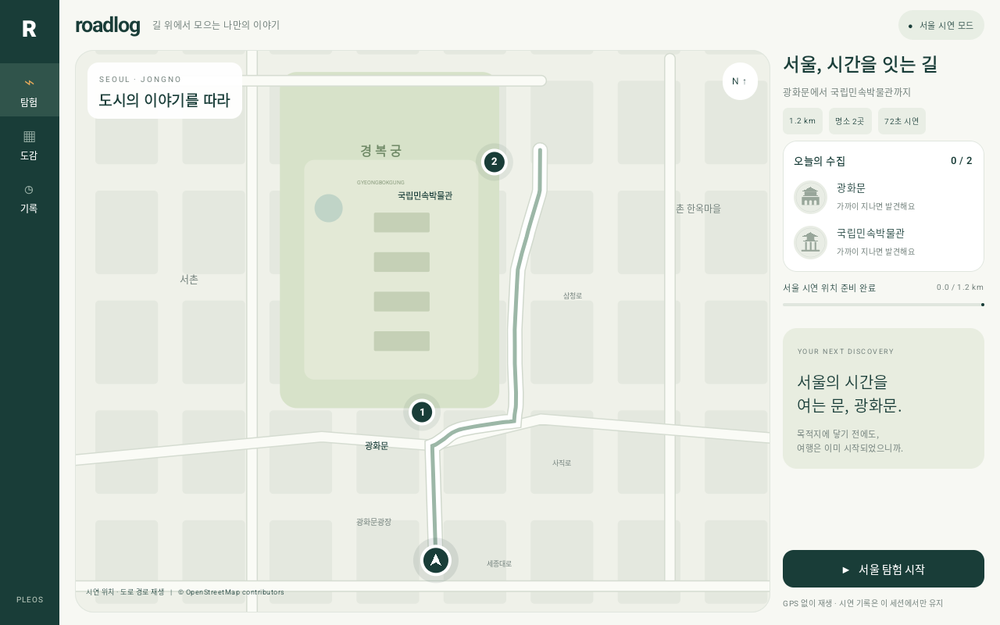

# Roadlog · 로드로그

**처음 가는 길은 새로운 발견이 되고, 다시 가는 길은 나만의 이야기가 됩니다.**

2026 현대자동차그룹 Pleos App Market 앱 개발 공모전을 위한 차량 기반 탐험·수집 서비스 프로토타입입니다. 서울의 도로를 따라 이동하며 명소를 발견하고, 나만의 뱃지 컬렉션을 완성합니다.



## 시연 보기

**[▶ 서울 탐험 시연 영상](docs/demo/roadlog-demo.mp4)** · **[시연 APK 다운로드](https://github.com/Chaejinn/Pleos-App-/raw/refs/heads/jhmin/apk/Roadlog-Seoul-Demo.apk)** · [뱃지 수집 화면](docs/demo/collection.png)

[시연 경로·촬영 안내](docs/DEMO_ROUTE.md)

| 서울 시연 코스 | 동작 |
| --- | --- |
| 세종대로 → 사직로 → 삼청로 | 약 1.2km의 도로 경로를 72초 동안 재생 |
| 광화문 | 근처 도로를 지나면 첫 번째 뱃지 획득 |
| 국립민속박물관 | 두 번째 뱃지 획득, 도감에서 2 / 2 확인 |
| 일시정지·재개·다시 탐험하기 | 같은 시연을 반복 촬영 가능 |

GPS·지도 API 키·인터넷 없이 실행됩니다. **서울 시연 모드**는 고정 경로를 사용하는 시뮬레이션으로, 실제 현재 위치가 아닙니다. 뱃지는 기존 명소 판정 엔진에 재생 좌표를 공급하여 획득하며, 실제 사용자 기록에 저장하지 않습니다.

## 실행

JDK 17, Android SDK 34를 준비하고 `local.properties`에 로컬 SDK 경로를 설정합니다. 기존 Pleos SDK 의존성을 최초로 받는 빌드에는 네트워크 접근이 필요합니다.

```powershell
git clone --branch jhmin https://github.com/Chaejinn/Pleos-App-.git
cd Pleos-App-
./gradlew.bat :app:assembleDebug
adb install -r app/build/outputs/apk/debug/app-debug.apk
adb shell am start -n com.roadlog.app.demo/com.pleos.explorer.demo.DemoActivity
```

1. **로드로그 Demo**를 실행하면 가로 화면이 열립니다.
2. **서울 탐험 시작**을 누릅니다. 위치 권한을 허용하거나 에뮬레이터 GPS를 설정할 필요가 없습니다.
3. 뱃지 두 개를 획득한 뒤 **도감**, **기록** 화면을 확인합니다.
4. **다시 탐험하기**로 수집 상태를 초기화하고 다시 촬영합니다.

디버그 앱은 `com.roadlog.app.demo`로 설치되어 기존 앱 `com.roadlog.app`의 데이터를 덮어쓰지 않습니다. 시연 기록은 메모리에만 유지되며 앱 프로세스가 종료되면 사라집니다. 앱이 백그라운드로 이동하면 시연이 일시정지됩니다.

에뮬레이터에 `System UI isn't responding`이 뜨면 Android Studio Device Manager에서 **Cold Boot**를 먼저 실행하세요. 이는 에뮬레이터 시스템 오류이며, 데이터 삭제 없이 재부팅할 수 있습니다. 앱은 자체적으로 가로 화면을 요청합니다.

## 구현 범위

- Kotlin / Jetpack Compose 기반의 가로 탐험 화면, 오프라인 지도 일러스트, 직접 그린 명소 뱃지.
- OSM/OSRM 도로 경로를 따라 움직이는 차량과 누적 경로 표시.
- 위치 기반 뱃지 획득 알림, 도감, 세션별 시연 기록.
- 시연 전용 Activity와 상세 연출은 `src/debug`에 포함. 차량용 release의 주행 중 제한 화면은 유지.
- 실제 Pleos 기기 GPS·차량 신호·지도 SDK 연결과 실차 UX 검증은 별도 작업입니다. 현재 화면은 상용 출시 완료 상태가 아닌 시연용 프로토타입입니다.

## 검증과 개발 문서

```powershell
./gradlew.bat :domain:test :app:testDebugUnitTest :app:lintDebug :app:assembleDebug
```

[검증 기록](docs/demo/VALIDATION.md) · [개발 문서](docs/README.md) · [기획서](docs/references/PLANNING.md) · [기능명세서](docs/references/FUNCTIONAL_SPEC.md)

경로 데이터: © [OpenStreetMap contributors](https://www.openstreetmap.org/copyright), ODbL 1.0. [OSRM](https://project-osrm.org/)으로 생성한 고정 경로이며, 배경 지도는 자체 제작한 개략 일러스트입니다. [원본 경로와 출처](docs/DEMO_ROUTE.md)를 참고하세요.
